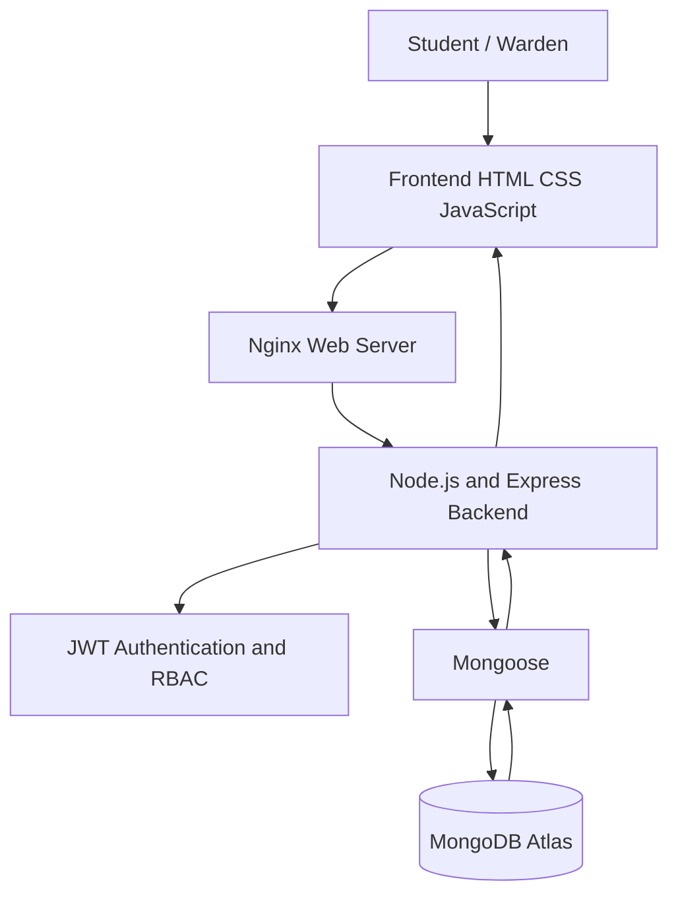
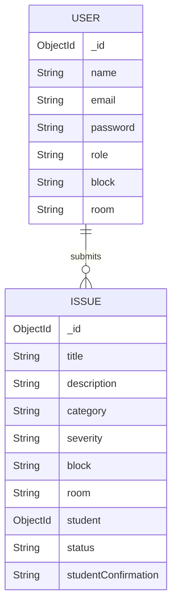

# FaultLens — Smart Hostel Complaint Management System

A full-stack web application for managing hostel complaints, tracking maintenance requests, and improving communication between students and wardens.

## 1. Project Overview

FaultLens provides a centralized platform where hostel students can report maintenance problems and monitor their resolution. Wardens can view complaints, update their progress, and manage unresolved issues.

The system aims to make hostel maintenance more transparent, organized, and efficient.

## 2. Project Objectives

- Provide students with an easy way to submit hostel complaints.
- Allow students to track complaint status.
- Help wardens manage and prioritize maintenance requests.
- Allow students to confirm repairs or report unresolved issues.
- Maintain complaint records in a centralized database.
## 3. Application Screenshots

### FaultLens Interface


**GitHub Repository:** https://github.com/soamsonali/FaultLens

## 3. Features

### Student Module
- Student registration and login.
- Secure password storage.
- Submit complaints with title and description.
- Select complaint category and severity.
- Provide hostel block and room details.
- View submitted complaints.
- Track complaint status.
- Confirm completed repairs or report unresolved issues.

### Warden Module
- Warden login.
- View complaints submitted by students.
- Monitor complaint statistics.
- Update complaint status.
- Manage unresolved complaints.

### Authentication and Authorization
- JWT-based authentication.
- Password hashing using bcryptjs.
- Role-based access for Students and Wardens.
- Protected API endpoints.

## 4. Technology Stack

| Technology | Usage |
|---|---|
| HTML5 | Frontend structure |
| CSS3 | Styling and responsive design |
| JavaScript | Frontend logic and API integration |
| Node.js | Backend runtime |
| Express.js | REST API development |
| MongoDB Atlas | Cloud database |
| Mongoose | MongoDB object modelling |
| bcryptjs | Password hashing |
| JSON Web Token | Authentication |
| dotenv | Environment configuration |
| CORS | Cross-origin request handling |
| Git and GitHub | Version control |
| AWS EC2 | Application hosting |
| Amazon EBS | EC2 block storage |
| Nginx | Web server and reverse proxy |
| systemd | Backend service management |

## 5. Project Architecture

FaultLens follows a client-server architecture.

1. The student or warden interacts with the frontend.
2. The frontend sends HTTP requests to the Express backend.
3. The backend validates requests and checks authentication and user roles.
4. Mongoose communicates with MongoDB Atlas.
5. The backend returns responses to the frontend.
6. The frontend displays the updated complaint information.

### Architecture Diagram



## 6. Project Folder Structure

```text
FaultLens/
│
├── backend/
│   ├── models/
│   │   ├── User.js
│   │   └── Issue.js
│   │
│   ├── createWarden.js
│   ├── server.js
│   ├── package.json
│   ├── package-lock.json
│   ├── .gitignore
│   └── .env.example
│
├── frontend/
│   ├── index.html
│   ├── login.html
│   ├── register.html
│   ├── student-dashboard.html
│   ├── warden-dashboard.html
│   ├── auth.js
│   ├── script.js
│   ├── student.js
│   └── style.css
│
├── .gitignore
└── README.md
```

## 7. Database Design

FaultLens uses MongoDB Atlas with two main collections.

### User Collection

| Field | Data Type | Description |
|---|---|---|
| name | String | User's name |
| email | String | Unique email address |
| password | String | Hashed password |
| role | String | Student or Warden |
| block | String | Hostel block |
| room | String | Room number |
| createdAt | Date | Account creation time |
| updatedAt | Date | Last update time |

### Issue Collection

| Field | Data Type | Description |
|---|---|---|
| title | String | Complaint title |
| description | String | Complaint details |
| category | String | Complaint category |
| severity | String | Low, Medium, High or Critical |
| block | String | Hostel block |
| room | String | Room number |
| student | ObjectId | Reference to User |
| status | String | Complaint status |
| studentConfirmation | String | Pending, Confirmed or Unresolved |
| createdAt | Date | Complaint creation time |
| updatedAt | Date | Last update time |

### Database Relationship



One student can submit multiple complaints. Each complaint references its submitting user.

## 8. REST API Documentation

The backend exposes REST APIs for authentication and complaint management.

| HTTP Method | Endpoint | Access | Purpose |
|---|---|---|---|
| GET | `/api/health` | Public | Check backend health |
| POST | `/api/auth/register` | Public | Register a student |
| POST | `/api/auth/login` | Public | Authenticate a user |
| GET | `/api/issues` | Warden | Retrieve all complaints |
| GET | `/api/issues/mine` | Student | Retrieve own complaints |
| POST | `/api/issues` | Student | Submit a complaint |
| PATCH | `/api/issues/:id/status` | Warden | Update complaint status |
| PATCH | `/api/issues/:id/confirmation` | Student | Confirm repair or report unresolved issue |

### Authentication

Protected endpoints require a JWT token in the request header:

```http
Authorization: Bearer <your_jwt_token>
```

### Example Registration Request

```json
{
  "name": "Student Name",
  "email": "student@example.com",
  "password": "your_password",
  "block": "A",
  "room": "101"
}
```

The registration endpoint assigns the Student role automatically.

## 9. Authentication and Security

The application implements the following security measures:

- Password hashing with bcryptjs.
- JWT token generation after successful login.
- JWT token verification for protected routes.
- Role-based authorization for Student and Warden routes.
- Password length validation during registration.
- Duplicate email checking.
- Environment variables for database connection and JWT secret.

Additional security hardening and testing should be completed before public production use.

## 10. Installation and Local Setup

### Prerequisites

- Node.js and npm.
- MongoDB Atlas account or a local MongoDB instance.
- Git.
- Visual Studio Code (recommended).

### Step 1: Clone the repository

```bash
git clone https://github.com/soamsonali/FaultLens.git
cd FaultLens
```

### Step 2: Install backend dependencies

```bash
cd backend
npm install
```

### Step 3: Configure environment variables

Create a `.env` file inside the `backend` directory.

```env
MONGODB_URI=your_mongodb_connection_string
JWT_SECRET=your_strong_secret_key
```

Use your own database connection string and a strong secret. Never upload the actual `.env` file to GitHub.

### Step 4: Start the backend

```bash
node server.js
```

The backend runs on port `7000`.

### Step 5: Start the frontend

Open the `frontend` directory using a local development server, such as the VS Code Live Server extension.

Make sure the frontend API configuration points to your local backend address.

## 11. AWS Deployment

FaultLens is deployed on an AWS EC2 instance.

### Deployment Components

| AWS / Server Component | Purpose |
|---|---|
| Amazon EC2 | Hosts the application and backend |
| Amazon EBS | Provides persistent block storage to the EC2 instance |
| Amazon VPC | Provides the virtual networking environment |
| Security Group | Controls inbound network traffic |
| Nginx | Serves frontend files and forwards API requests |
| systemd | Manages the backend service |
| MongoDB Atlas | Stores application data |

### Deployment Workflow

1. The application is hosted on an EC2 instance.
2. Nginx serves the frontend files.
3. API requests are forwarded by Nginx to the Node.js backend.
4. The backend communicates with MongoDB Atlas.
5. systemd manages the backend process and restarts it when required.

**Live Application:** http://51.20.135.140